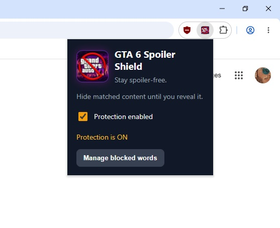
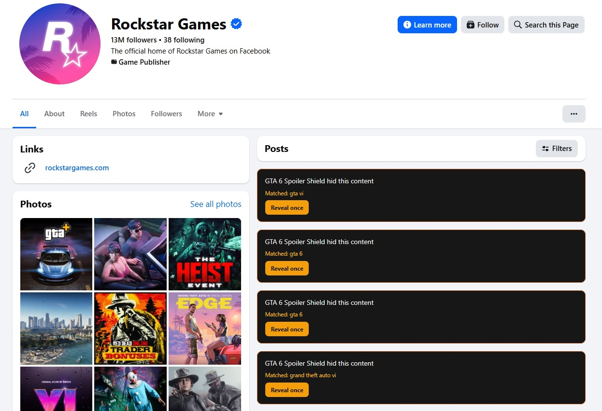
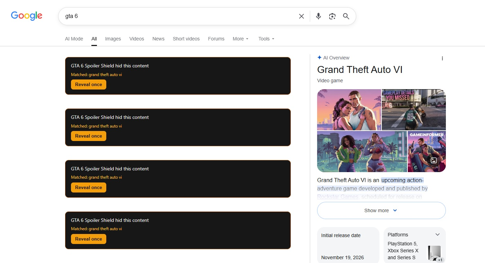
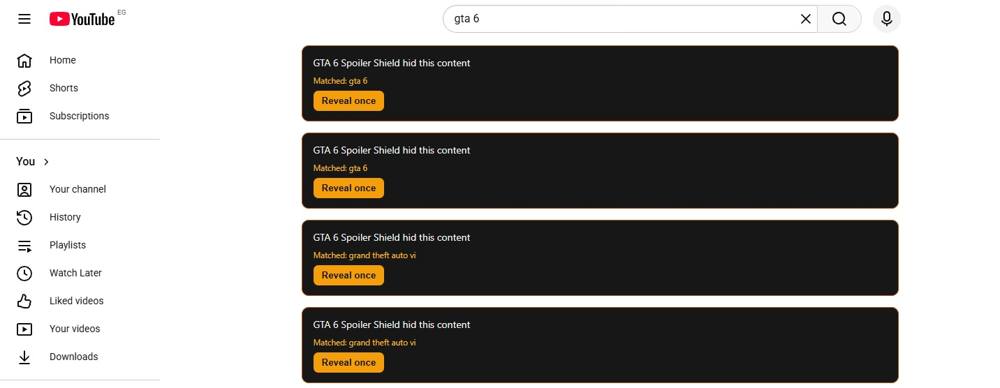
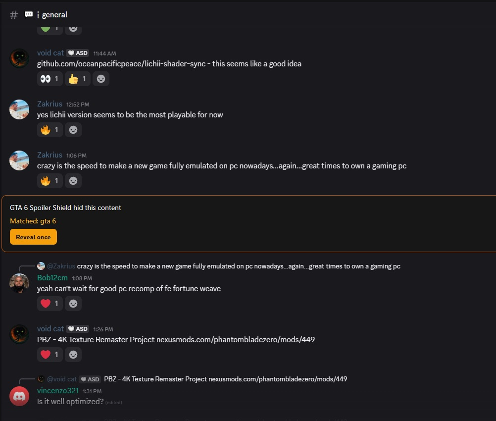
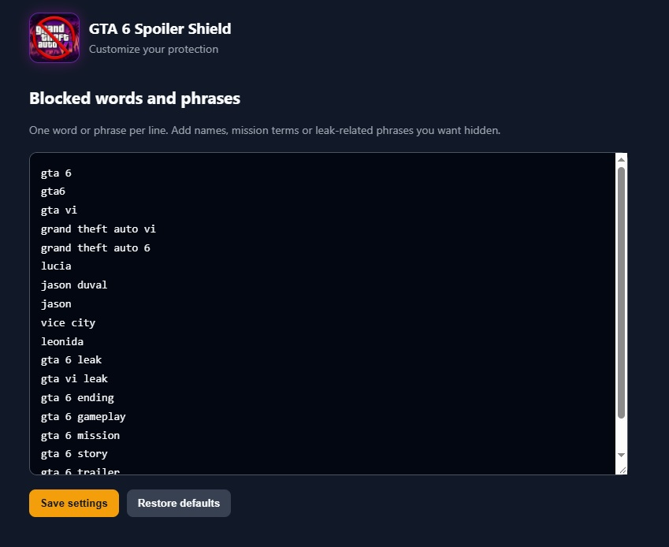

# GTA 6 Spoiler Shield — MVP 0.1

A Chromium browser extension prototype for Chrome and Microsoft Edge.

## Install (developer mode)
1. Extract the ZIP to a permanent folder.
2. Open `chrome://extensions` in Chrome or `edge://extensions` in Edge.
3. Turn on **Developer mode**.
4. Choose **Load unpacked** and select the extracted `GTA6_Spoiler_Shield` folder.
5. Pin the extension. Open its popup to turn protection on/off.
6. Use **Manage blocked words** to customize the phrase list.

## Included in this MVP
- Targets YouTube, Facebook, Reddit, Google Search (google.com, google.com.eg and google.co.uk), X/Twitter, TikTok and Discord (discord.com).
- Hides matching text-based cards/posts/comments/results.
- Adds a **Reveal once** control to each hidden item.
- Lets you pause protection and edit the blocked phrase list.

## Limitations
- This is a first prototype, not a guarantee against every spoiler.
- It scans visible text; it does not perform OCR on images or inspect video/audio content.
- Discord support scans text in web Discord message elements; Discord layout changes may require selector maintenance.
- Website layouts change frequently, so selectors may need maintenance.
- The initial keyword list is deliberately editable. Broad terms such as `Jason` or `Vice City` can hide non-spoiler content too; remove or refine them if filtering is too aggressive.
- This is a browser extension, not a system-wide Windows screen filter. It does not inspect desktop apps or Windows notifications.

## Privacy
The extension does not send browsing content to a server. Matching happens locally in the browser. Settings are stored using Chrome's synced extension storage.
## Screenshots

